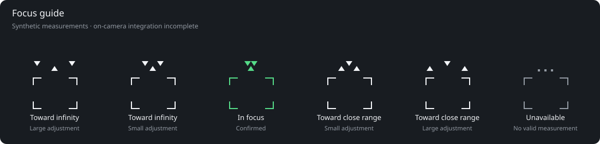

# Manual focus guide

**Deferred at the user's request.** Preserve the implementation and evidence
for possible later work. Runtime integration, activation and calibration are
out of scope for the current BF+ deployment. Do not add guide/PAS hooks or
make focus readiness a blocker for the other features. The UI owner remains
the sole installer; the focus task holds camera writes. Resume only when the
user explicitly requests it.

**Status: offline implementation; not yet a working camera feature.** The
indicator, continuous phase receiver, session calibration, matcher, native
painter and display-lifecycle adapter are implemented. Only the passive guide
core is linked into normal BF+; there is no Focus Guide menu option yet. The
current UI/aspect installation candidate deliberately excludes this work.

The requested lens has no electronic contacts. BF supports registered manual
lenses, but those profiles do not contain the electronic-lens phase maps. A
scoped hardware diagnostic recovered textured paired images and collected
focused, near-setting and far-setting references. These establish a useful
research path, not a validated green band or continuous acquisition timing.

The diagnostic was removed, all baseline 22 BF+ hooks at `0x4475bf000` were
preserved, and a playback-to-shooting transition restored **both complete
512-byte SPT tables to zero**. The hardware window was explicitly released
to the UI/aspect work. No focus diagnostic remains installed as of that handoff.
Further camera use must be coordinated with the current installer.

The behavior reference is Canon's
[EOS R3 Focus Guide](https://cam.start.canon/en/C010/manual/html/UG-04_AF-Drive_0070.html).
The code and geometry are original; no Canon assets or Sigma firmware bytes
are distributed.



## Implemented behavior

| Condition | Guide |
| --- | --- |
| Disabled, autofocus, or magnified display | Hidden |
| Invalid, low-confidence, stale, or absent measurement | Gray frame and dots |
| Positive calibrated error | White pointers; adjust toward infinity |
| Negative calibrated error | White pointers; adjust toward close range |
| Larger error | Greater pointer separation, bounded to the frame area |
| Confirmed focus | Green frame and aligned pointers |

Focus confirmation requires a configured number of distinct, fresh sensor
measurements. Repainting the same frame never adds confirmations. Separate
entry/exit thresholds prevent flickering around focus. Loss of measurements
resets both confirmation and that hysteresis. The painter checks expiry even
if the producer stops sending updates.

The target defaults to the center of the 1024×682 logical display. Its API
accepts a new position and subject identity; it clamps the complete indicator
to the display. Mode, target, and calibration changes advance an acquisition
generation so delayed frames cannot confirm a newly selected target.
Physical tap/controller input and automatic eye/face placement are not wired
to this API yet. Subject detection alone is never evidence of focus.

## Measurement and rendering contract

Call `focus_guide_init`, then `focus_guide_configure`, and set the actual mode
with `focus_guide_mode`. Invalid or missing configuration produces unavailable
guidance. There are deliberately **no default optical thresholds**.

The adapter must establish all of the following before producing valid samples:

- Signed defocus with positive meaning **adjust toward infinity**, not a lens
  ring's clockwise direction. Three physical reference captures support the
  provisional paired-image conversion `focused_zero - raw_shift`; independent
  repeatability and direction validation are still required.
- A calibrated unit scale and thresholds satisfying
  `0 < focus_enter < focus_leave < large_adjustment <= INT32_MAX`.
- Confidence in the range 0..1000, derived from understood native validity and
  quality information. A zero defocus value alone is not a valid reading.
- The sensor acquisition time in the same millisecond clock domain as the UI,
  plus a sequence that advances for each genuinely new measurement. The host
  read time, UI update count, and buffer address are not substitutes.
- The guide's generation captured **when acquisition starts** for the selected
  target, not attached later to cached data. A moved target invalidates prior
  confirmation even when its subject identifier remains the same.
- A consistent publication for the relevant target, aspect ratio and mode.

`focus_guide_update(guide, NULL, now)` is a clock tick and retains a fresh
indication until expiry. A sample with `valid != 1` removes guidance immediately.
Sequence and millisecond counters may wrap at 32 bits; intervals must be below
2^31. Backward counters, changed data under the same sequence, and sequences
advancing without acquisition time advancing are rejected. Reconfiguration
must go through the API. One UI-thread owner must serialize these calls.

`focus_guide_paint` emits rectangles and triangles through a callback with
abstract gray/white/green colors. Rectangle ends are exclusive. The display
adapter must map the colors to the native surface, restore the previous overlay
on every redraw/target move/hide, and coordinate with stock AF frame drawing.
It must not paint into the captured image. The standalone native surface
adapter in `focus_guide_render.c` now clips marks and calls the BF 1.04 OSD
rectangle primitive. It remains unlinked. The display service contract below
implements redraw/hide ordering, but its native hooks and guide installer
integration are still pending.

Five native-emulation test groups exercise the actual firmware fill routine
with this adapter: clipping at each edge and extreme signed coordinates,
eight halfword alignments and padded pitches, inclusive triangle base/tip
rows, invalid surfaces/marks, dirty-row preservation, and every core state.
The tests verify buffer canaries and the AArch64 calling convention. They
do not establish physical color appearance or display scheduling. Foreground
colors use the native four-nibble format, not RGB565.

## Continuous acquisition and session calibration

`focus_capture.c/.h` observes the native pair-1 receiver. It copies a fixed
central 128×24 region from the measured 1514×334/1536-byte writer layout into
one owned mailbox slot. An unclaimed frame can be replaced; a frame held by
the UI consumer cannot be overwritten. The native program, waits, IRQ callback
and submission still execute once with their original arguments and results.
`focus_sensor_router.S` preserves the native caller LR/SP and x20–x23 before C.
The seven exact BL hooks use the reserved island at `0x4d3321190`.

The receiver checks source/request epochs, distinct acquisition timestamps,
program/consume sequences, both wait results and stop bits, IRQ completion
and error counters, both pair-bank whitelists, both writer geometries, scene and Lens+
identity before and after copying. It invalidates source cache ranges and
rejects acquisition age above 100 ms or copies above 10 ms. Stop/error recovery
requires a new consume baseline. Completion evidence cannot be credited to
two overlapping receiver generations. Neither newly programmed pair may reuse
the pending primary source pair. These are bounded software checks:
**hardware bank attribution, DMA/cache coherence and complete lifecycle
observability remain unproven**, explicitly recorded in the frame ABI.

`focus_live.c/.h` has one UI-task owner. A user calibration action collects
eight distinct, qualified, spaced frames with bounded spread and timeout.
It stores session medians for the primary support and both fixed horizontal
halves. Later guidance requires all three matches; the zero-corrected tile
residuals must agree. The adapter never moves or shrinks its region to rescue
a failed match. Calibration frames cannot confirm themselves: the runtime
advances the acquisition generation and requires new frames afterward.

Changing the selected manual-lens slot or its profile bytes discards the
reference. A source discontinuity resets confirmation. Matching latency does
not refresh acquisition time, and the painter checks age independently.
Physical lens or aperture changes that produce no electronic/profile change
cannot be detected automatically and require recalibration. A session zero
alone does not determine acceptable sharpness or a safe green tolerance.
No production policy or optical thresholds are populated by default.

Activation is a remaining integration requirement. Enabling the scoped table
adapter does not itself restart PAS. Native mode 0 → 0 with unchanged subtype
queues no restart, so closing an ordinary menu cannot be relied upon. An actual
magnification mode 6 → 0 return queues the native restart; playback → still
also reinitialized the tables in the completed hardware experiment. No safe
same-mode forced-reset API has been established. The menu/runtime integration
must expose pending activation, associate both table fills and native setup
completion with the current enable epoch, then require fresh matching capture
before reporting live data. These readiness receipts are not implemented yet.
It must not mistake the aggregate diagnostic fill counter for that handshake.

The accepted reference directories are
`.touch-focus/owned-phase-{focused,near,far}-reference/`. Replaying their
centered 128×24/S32 crops gives:

| Reference | Raw displacement Q8 | Correlation | Peak margin | Texture RMS |
| --- | ---: | ---: | ---: | ---: |
| Focused | 102 | 893 | 161 | 19 |
| Near setting | -83 | 935 | 83 | 18 |
| Far setting | 1195 | 960 | 13 | 14 |

The ordering supports the provisional adjustment sign, but the far peak is
broad and nearby spatial crops disagree. None of the geometries tested in the
replay accepts all three references under the unchanged synthetic test gates.
High correlation is not an optical-focus probability. Mixed-capture A/B pairs
can also pass statistical gates, so matching cannot replace acquisition
ownership. The older `.touch-focus/raw-phase-focused-reference/` was captured
in an unsupported magnified/frozen state and must not be used for calibration.

## Display lifecycle adapter

`focus_ui.c/.h` is a focus-owned adapter for the future shared compositor.
Its services take a consistent scene snapshot and submit checked native jobs
from the UI task. It permits painting only after the exact normal-still full
foreground callback `0x4d3394c90`, in landscape, with a matching scene epoch.
The OSD worker paints a copied live view and never submits another job.

Before a scene/orientation change or removal, the adapter inhibits future
paint and acquisition, requests a full stock foreground repaint, verifies its
receipt, then submits an all-null barrier. Native completion happens before
the previous dirty-buffer copy; the second submission closes that lifetime.
Failed repaint, missing receipt, failed presentation or barrier failure retains
ownership and blocks the handoff. If the scene already changed, it reports
lost ownership instead of repainting the old still screen over a new scene.
Callback storage and resident memory must survive removal until reboot.

This is an implemented service contract, not completed global-UI integration.
The UI owner must supply persistent callback triples, checked completion
receipts, scene snapshots and pre-transition/removal calls. Native compositor
and camera tests of that composition are still required. Initial display scope
is the center of normal landscape still view; magnification, movie, playback,
menus, other foreground families, portrait and movable targets remain hidden.

## Why the stock phase producer is inactive without contacts

Analysis used the supplied local BF 1.04 segment05 with Capstone and Unicorn,
plus read-only PTP samples. These are local analysis results, not REA runtime
evidence. Addresses below apply only to that firmware.

The phase worker at `0x4d32c9e00` has two relevant gates:

| Address | Observed behavior |
| --- | --- |
| `0x4d3155ce0` | Tests whether `0x4d31d48c0()` returns lens class 2 |
| `0x4d32ca02c..0x4d32ca034` | Initialization takes a fallback path for other lens classes |
| `0x4d32c9f44..0x4d32c9f4c` | Per-frame processing skips the phase producer for other lens classes |
| `0x4d32ca0d4..0x4d32ca0f4` | Additional electronic-lens capability checks |
| `0x4d32ca120` | Calls phase processing at `0x4d32c7fa0` only after those checks |

The optional native tests execute both gate paths from the original local
firmware. No-contact/class-0 lenses skip both. Class-2 lenses must also pass
the relevant capability bits. This explains the observed frozen data, but does
not establish that running the calculation with missing lens metadata would
produce useful results. Merely overriding the global lens getter would affect
unrelated AF behavior and is not implemented.

### Custom manual lenses (Lens+)

The camera does support registered manual lenses. The diagnostic now reads
that table automatically. A live read on 2026-11-12 found **28mm F2.8** and
**35mm F2.8**, both without registered color-shading compensation. These are
stored profiles, not observations of the mounted lens or its current aperture.
Sigma describes this feature as lens information and color-shading compensation
in the [BF manual, pages 113–114](https://www.sigma-global.com/en/support/download/BF_EN.pdf).

| Address/offset | Verified role |
| --- | --- |
| `Q(0x4d72aa4e8)` | Table beginning with the 16-byte `_ManualLensInfo_` signature |
| Table `+0x10 + 10*slot` | Eight profile bytes, followed by previous/next slot links; ten slots |
| Profile `+0/+2/+4/+5/+6` | Focal length in mm, registered aperture in tenths, optional A–Z suffix, F/T selector, color-shading registration flag |
| Table `+0x74/+0x75/+0x76` | Registered count, first and last active slots; deleted slots can retain data |
| `0x4d31a2d00`, via `0x4d33184c0` | Native profile getter; wrapper rejects slots above 9 |
| `0x4d3318480`, via `0x4d3321150` | Selected profile, stored at `Q(0x4d7301b98)+0xb4` |
| `0x4d31489f0` | Uses the selected manual profile's focal length, scaled by ten |
| `0x4d31d4910` → `0x4d31d6180` | Separate electronic-lens snapshot; returns 128 zero bytes without the electronic-lens event bit |

Unicorn tests execute those native getters: a selected 35mm manual profile
produces focal length 350 in the general metadata path, while the electronic
snapshot remains empty. The phase initializer uses the latter path. Selecting
a Lens+ profile therefore does not, by itself, supply its calibration data.
The registered F/T value must not be treated as a live aperture reading or
used to claim that phase calibration is complete.

On this camera, the selection lives at `0x400d00cb8`, below the vendor PTP read
window starting at `0x400d10c00`. The probe reports
`selection_status: outside_ptp_window` and `selected_profile: null`, while
still listing the registered profiles. It does not wrap an unsigned offset or
guess which profile is selected. The continuous in-camera adapter uses the
native getter. Table parsing validates the signature, bounds and linked list;
changes to a table, selection or pointer during a read discard the selection.

### Initialization findings

The stock initializer is more than a lens-class check. `0x4d319a7c0` builds a
20-byte descriptor from electronic-lens data. The old-protocol path indexes
counts at lens table `+0x211/+0x212`; zero counts underflow to index 255.
`0x4d32c5920` then calls `0x4d319a4a0` for lens-specific maps and
`0x4d319c7c0`/`0x4d31da7f0` for optical parameters. A profile's focal length
and F/T label are not replacements for these arrays.

The no-contact fallback at `0x4d32ca038..0x4d32ca054` clears two 512-byte
hardware correction tables, then runs hardware setup at `0x4d32cb930` and
`0x4d32d5e60`. Live reads confirmed zero prefixes at `0x41a0d1c94` and
`0x41a0d1e94`, with the worker's first-frame flag still set. The electronic
calibration allocation and old phase descriptor retained nonzero data; their
presence is not evidence that they belong to the current manual lens.
These initial reads did not modify the global lens class or correction tables.

Native execution tests now verify this distinction directly: the fallback
calls the real byte `memset` with value `0x1000`, producing zero bytes. A
reference-fill block at `0x4d32c5b6c..0x4d32c5d6c` writes 256 **halfwords** of
`0x1000` to each of the same tables. Tests cover all eight halfword alignments
and unchanged surrounding canaries. The hardware experiment below confirms
that correcting this fill changes the sampled PAS crops from zero to textured
images on the tested no-contact lens.

`touch_focus/focus_pas.h` contains a scoped correction, currently
**unlinked and disabled in normal BF+ builds**. A separate temporary add-on
was used for the completed hardware experiment and has been removed. It replaced only the two fallback call sites and
requires the no-contact class, exact corresponding table address, value and
length. All other cases retain the native byte-fill behavior. The proposed
branch island preserves the native Lens+ profile getter for ordinary callers.
Five AArch64 tests exercise both native fallback calls, ordinary profile calls,
invalid arguments, other lens classes, default-disabled behavior, and ABI
preservation. The separate add-on also passed 17 lifecycle/wrapper tests and
seven host ownership/removal tests before installation.
Removing its hooks after the experiment also requires native
reinitialization or a power cycle to restore already-loaded hardware tables.

On 2026-11-12, a lit-subject baseline contained only zeros in all 8,192 pixels
of each pair-1 crop. After installing the add-on and a user-operated
playback-to-shooting transition, its counter reported exactly two fills,
zero rejected calls, and lens class zero. Both complete 512-byte tables matched
256 halfwords of `0x1000`. All three subsequent pair-1 captures contained
texture (standard deviations approximately 65–68); pair 2 was textured too.
The existing 22 BF+ hooks and installation record remained unchanged.

These host captures span changing metadata and are explicitly **not coherent
sensor acquisitions**. Pair-1 horizontal correlation peaks were approximately
0.67–0.68 at shifts 0–1 pixels; pair 2 peaked at the search boundary and must
be rejected. These observations establish usable-looking input for further
research, not an optical zero, near/far sign, or focus confirmation.

## Paired-image research path

The raw-image alternative avoids invoking the electronic-lens phase producer.
The temporary diagnostic corrected the earlier SPT fill as described above. The pending
record at `0x4d72faf50` contains two image pairs at `+0x138/+0x140` and
`+0x148/+0x150`. The four legal pointer tuples are in the firmware's table at
`0x4d3df2110`; the probe validates that table and never follows other addresses.

For the supported still consumer layout, the PBLM descriptors at
`0x4d35a5980` and `0x4d35a59ac` describe byte images with strides 1536 and 512.
The diagnostic samples a 256×32 interior crop from each pair. Consumer layout
alone does not prove that the writer is active. The probe also checks the
cached PAS descriptor at `0x4d72fb0a8`, layout mode at `0x4d70342e4`, channel
count at `0x4d72fba22` and row offsets at `0x4d72fba28`.

A live read found direct layout 3, four channels, eight-bit output, row offsets
1536/512 and height 334. Before the correction, the sampled regions in **both pairs were all zero**.
Some bytes outside the chosen columns changed; these cannot be reported as
texture in the crop. A repeated read can also match while its metadata rotates.
The probe records pending-skip state and rejects changed metadata/configuration
as a consistent pair. Even a fully matching capture is not a fresh publication
protocol: buffers rotate and DMA can reuse them.

The metadata timing fields are now traced: `+0x10` is sampled by the SSG
interrupt callback at `0x4d32be0b4` from `DD_TIMESTAMP_Get_Counter`; the nominal
scale is 24 MHz. `+0x18/+0x20` are derived end/start values, not measured DMA
completion times. Skip-zero records contained changing nonzero timing values;
skip-one records often contained zeros. Native code can reuse a timing tuple,
so neither a host read nor a submission count is a sensor acquisition sequence.

The native submission call at `0x4d32bf1e0` is used for a synchronous
copy of **pair 1** into owned memory. Its completion wait covers channels 0/1;
pair 2's completion is not established by that wait. The published buffers
can be reused on the next receiver invocation and must not be retained for
asynchronous correlation. Wait-error and recovery handling now have native
execution tests. Hardware bank latching and DMA/cache visibility still need
verification before deploying the continuous adapter.

Capture the current supported writer layout without changing the camera:

```sh
.venv/bin/python bf_focus_raw_probe.py --pair 2 --samples 3 --output .touch-focus/raw-phase-new
```

Use a new output directory. Pair 1 is available with `--pair 1`; larger spans
are read in bounded chunks. Captures retain both repeated copies and complete
metadata/configuration. The transport lock, firmware checks and no-retry rules
are shared with the original phase probe. A busy transport or failed capture
does not overwrite prior evidence.

The probe also records the scene stack, depth and pending transition. A live
test found that native punch-in (`depth=3`, scene `0x4d33a1400/0x4d33a13d0`)
leaves old phase pixels and timestamps perfectly readable and repeatable.
Those captures are now marked `unsupported_scene`; repeated timing across
host samples is reported explicitly. This case has two regression tests.
It must not be used as an in-focus reference, even when image correlation is high.

`touch_focus/focus_phase.c` is an original, integer-only normalized correlation
matcher for these byte crops. It removes per-row intensity offsets, measures
texture, checks peak separation and rejects flat, tied or boundary peaks.
It has no default configuration and returns **pixel displacement**, not
calibrated defocus or a physical near/far direction. Known synthetic shifts,
exposure differences, repetitive patterns, low texture, unrelated noise,
occlusion, maximum contrast and AArch64 execution are tested. Its AArch64 text
is 888 bytes at `-Os` with no runtime helpers. It is not linked into BF+ yet.
Neither synthetic tests nor a successful correlation would establish optical
zero, direction, acquisition age or a focus-confirmation threshold.

## Phase-data provenance

| Address/offset | Observation |
| --- | --- |
| `0x4d3159120` → `0x4d31553e0` | Stock AF display result: 0x68 bytes from `0x4d72a41f0`, with timestamp at `0x4d72a4270`; this is status/rectangles, not signed defocus |
| `0x4d3194310` | Returns AF state at `0x41a0dc800` |
| AF state `+0xff0` | Previously consumed phase context; can remain stale when AF is inactive |
| `0x4d7028698` | Phase context ring `{index, capacity, count, stride}`; capacity 16, stride 0x2f8 |
| `0x4d72aa130` | Sixteen context pointers |
| `0x4d3192e60`, via `0x4d31590e0` | Allocates the next context; advances the ring before clearing/filling the record |
| `0x4d32c9488..0x4d32c9584` | Producer populates the context; grid pointer goes at `context+0x78` |
| `0x4d3271440` | Native consumer uses 45 columns and 27 or 23 rows, depending on mode |
| `grid + 4*cell` | Signed 32-bit candidate measurement |
| `grid + 0x4272 + 2*cell` | 16-bit flags; one native consumer requires bit0, another requires `(flags & 0x71) == 1` |
| `0x4d31591f0` | Converts the signed value using a signed-16 normalization parameter |

The conversion observed is `(signed_raw * 65536) / ((normalization * 0x30a) >> 8)`.
The normalization reaches the detector via lens-related metadata and
`0x4d3155080` → `0x4d331a010` → `0x4d331a150`. Its optical meaning and the
physical direction of the resulting sign are not established. The core does
not invoke this conversion or invent thresholds for it.

On 2026-11-12, the current manual-lens setup produced five read-only snapshots
over 926 ms with:

- Ring index 12 throughout, context `0x41a111da0`, grid `0x41a087d00`.
- All 1,215 sampled cells invalid under both observed native flag checks.
- Identical phase/flags hash throughout:
  `116c90e0b23df479c328e84c724826cbc519baf37d6eb6d5ff0b51ad89bb5dc0`.
- Matching before/after context, pointer and ring headers for each read.

Earlier samples also showed a frozen AF-display timestamp and consumed phase
context while subject-detector buffers changed. Matching memory reads alone
do not prove acquisition freshness or atomicity, and ring reuse can produce
an ABA race. These observations are not an input adapter.

A later three-sample capture, including registered manual-lens profiles, again
had zero valid cells. Its ring index was 9, context `0x41a1114b8`, and center
value -684265 with flags `0x80`. The same data persisted over 499 ms. This
also demonstrates why a nonzero signed value must not be accepted without
validity and fresh publication evidence.

## Reproduce the diagnostic and preview

With the camera awake in the existing MTP connection:

```sh
.venv/bin/python bf_focus_guide_probe.py --samples 5 --output .touch-focus/guide-capture.jsonl
```

The probe checks the existing firmware fingerprints, honors the shared PTP
transport lock, checks pointer/ring bounds, and issues reads only. It never
enables autofocus, patches a callback, writes RAM, or retries a failed
transaction. The output file must be new. `host_elapsed_ms` is explicitly a
host observation time; the output contains no claimed sensor timestamp,
calibrated direction or focus confirmation. The 45×27 diagnostic window is
for still-view research; it is not a movie-coordinate mapping.
Each sample also includes `manual_lens`: registered Lens+ profiles and the
selection when it is readable. This metadata does not enable phase processing.

Generate the preview from the actual C painter with synthetic test units:

```sh
mkdir -p .touch-focus
clang -std=c11 -Wall -Wextra -Werror tools/focus_guide_preview.c touch_focus/focus_guide.c -o .touch-focus/guide-preview
.touch-focus/guide-preview > docs/focus-guide-preview.svg
```

## Validation and remaining integration

```sh
.venv/bin/python -B -m unittest discover -s tests -p 'test_focus_*.py' -q
```

The complete focus suite passes **157 tests**, including 40 native receiver
tests, 17 synthetic calibration/runtime tests, 13 display-lifecycle tests and
four native capture-to-framebuffer pipeline tests. All owned AArch64 modules
pass the payload relocation whitelist and link together with no unresolved
runtime dependencies. Native firmware tests require the user's local
decoded image; Unicorn needs a host that permits its JIT.

These checks cover native argument/result preservation, mailbox ownership,
error/stop recovery, freshness, calibration, spatial disagreement, native
rasterization and display handoff failure paths. The display adapter's queue
services are controlled fixtures; they do not establish its integration with
the production compositor, physical scanout or RTOS scheduling.

Remaining work is shared payload/menu/host integration; activation readiness;
checked native UI services and removal; bounded package sizing; and a coordinated hardware test
of continuous capture, latency, repeatability, near/far direction, calibrated
green, gray failures and scene transitions. The three single-frame references
cannot select production thresholds. Movable/subject-selected targets require
separate sensor-to-display mapping and are outside the initial center scope.

## Upload and resident memory

The fixed per-transfer/staging limit remains 0x4000. The segmented loader can
transfer a larger resident image without raising that limit. The linker separates the initialized
prefix (`__image_end`) from the complete resident extent (`__end`). State/logs
and other zero-initialized objects occupy a `NOLOAD` BSS tail. Bootstrap allocates
the complete extent plus alignment slack, copies only the uploaded prefix,
zeros the resident tail, initializes identity and guide state, and publishes
the complete resident range before installing hooks. The host-configured
subject-detection option and control block remain in the uploaded prefix.

The builder rejects resident extents over 64 KiB,
unexpected allocated sections, invalid section bounds, unsupported relocations
and unresolved runtime dependencies. The 64 KiB resident guard is a software
limit, not a measured firmware allocation guarantee. Launcher bytes and entry
offsets are unchanged. Removal continues to use the exact saved image and
symbol offsets for each installation, including previous layouts.

An isolated snapshot linking the contemporary UI plus capture/live/matcher/
painter/router reached **58,560 initialized bytes / 75,712 resident bytes**,
before the display adapter and actual menu seams. The existing 64 KiB assertion
correctly rejected it. This is size evidence, not an installable package or a
current measurement of the independently changing UI tree.

The UI owner has explicitly kept the current UI/aspect/loader candidate at
64 KiB and excluded focus. A later focus integration is expected to use an
explicitly bounded 128 KiB resident package, subject to coordinated allocation,
cache, ABI and removal tests. No shared bounds were changed by the focus task.
The loader's 16 KiB transfer cap, immutable saved installation artifacts and
retained-resident removal rules continue to apply.
